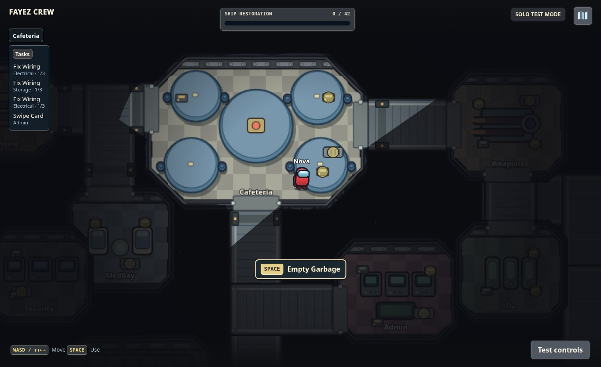
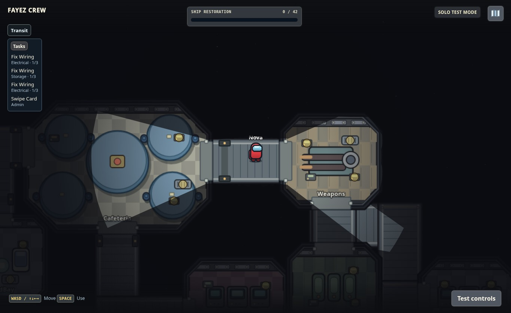

# Meridian deck overhaul

Meridian is Fayez Crew’s original ship. The supplied Skeld plan informed the broad engineering, cargo, and navigation routes. The 14 room footprints, 22 room thresholds, and 13 sabotage shutters share world coordinates with movement, the physical view and the blue map. [The Skeld reference map][skeld]

- The western Cafeteria hall connects Upper Engine and a terminal MedBay spur. The north–south engine spine joins the two engines, with Reactor and Security opposite each other at its midpoint. Electrical is a spur off the Lower Engine–Storage hall.
- The central Cafeteria trunk reaches both the Admin spur and Storage. The south hall connects Storage to Shields and branches into Communications. Weapons opens to the eastern trunk, with O2 as a side room and Navigation and Shields reached from the lower junction.
- Threshold plates are always passable. The shutters have tracks and lights when open. The server rejects a closure when a living suit obstructs it, then broadcasts successful closures and auto-reopens them after 9.5 seconds. Walls and closed shutters are used by movement and line-of-sight validation.
- The blue map uses the live room and corridor geometry. The player position and next unfinished task stages are shown. Closed shutters appear in red, and active repair stations use the same coordinates as the physical deck.
- In flight, the task preview is at the top left, the shared progress bar is centered, and the top-right Map button also responds to M. Space uses the nearby valid interaction shown in the lower center. Chat and Ballot share a meeting panel and timer. The chat tab tracks unread messages and preserves drafts while players switch views.

[Task research and stage rules](SKELD_TASK_REFERENCE_AUDIT.md)

## Character and environment scale

Approximate silhouette measurements exclude hats, names, benches, and wall trim. Source screenshots have different resolutions, so the comparisons use ratios rather than literal pixels. Fayez figures are world units at the same camera scale.

| Comparison | Among Us reference | Earlier Fayez Crew | Current Fayez Crew |
| --- | --- | --- | --- |
| Suit height / central Cafeteria table | 39 / 125 in the wide view, about 31% | 51 / 64, about 80% | 34 / 112, about 30% |
| Suit height / satellite Cafeteria table | About 40 / 126, or 32% | 34 / 42–46, about 74–81% | 34 / 78–84, about 40–44% |
| Suit width / Weapons corridor | 26 / 103, about 25% | 37 / 62, about 60% | 25 / 74, about 34% |
| Suit width / marked doorway opening | 26 / 88–100, about 26–30% | 37 / 56, about 66% | 25 / 70, about 36% |
| Suit height / Electrical room width | 37 / 285, about 13% | 51 / 170, about 30% | 34 / 210, about 16% |
| Suit height / Electrical panel bank | 37 / about 190, about 19% | 51 / about 78, about 65% | 34 / 164, about 21% |
| Suit height / Reactor machinery | 34 / 85 beside the reference column, about 40% | 51 / 66, about 77% | 34 / 78, about 44% |

Meridian keeps the clean, rounded suit silhouette, the 0.67 world drawing scale, a nine-unit movement radius, and a camera zoom cap of 1.52 from the earlier character correction. This pass grew the satellite tables, Reactor machinery, and Electrical wall cabinet bank. Nicknames remain screen-readable and the movement speeds and interaction distances retain the prior world units. Meridian’s doors and satellite tables have their own proportions.

| Authentic gameplay reference | Fayez Crew |
| --- | --- |
| ![Among Us Cafeteria and tables][cafeteria] |  |
| ![Among Us Weapons corridor][corridor] |  |

[Electrical gameplay reference][electrical] · [Reactor gameplay reference][reactor] · [Screenshot gallery](screenshots/passage-hud/)

[skeld]: https://among-us.fandom.com/wiki/The_Skeld
[cafeteria]: https://cdn.mobygames.com/0a600cc6-c3a1-11ed-9226-02420a000121.webp
[corridor]: https://cdn.mobygames.com/68277b2a-ac20-11ed-a12e-02420a000130.webp
[electrical]: https://cdn.mobygames.com/65992b74-ac20-11ed-b444-02420a000134.webp
[reactor]: https://cdn.mobygames.com/69cad43a-bf22-11ed-9c42-02420a000140.webp
