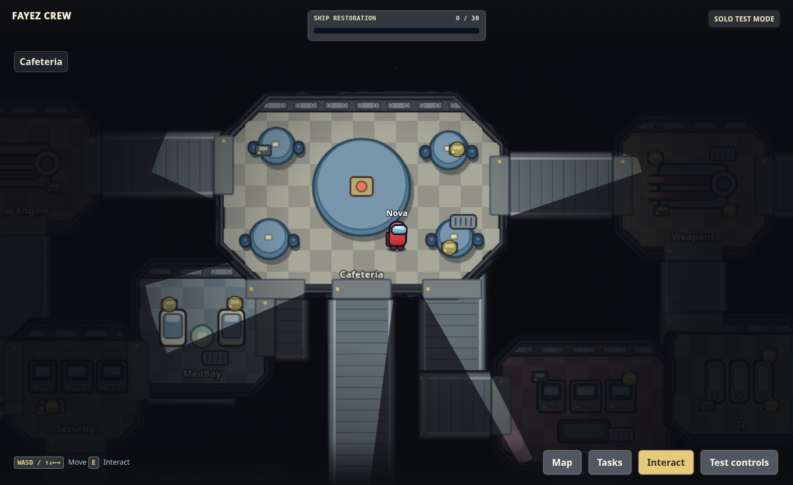
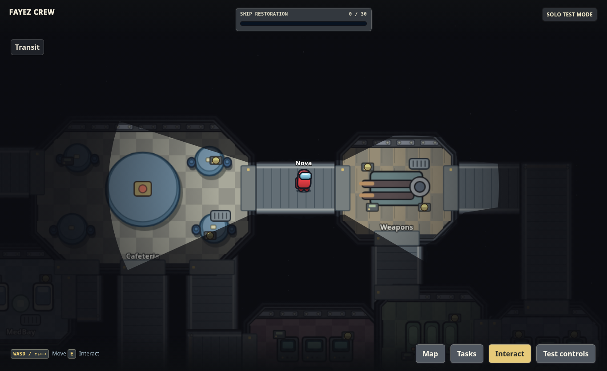

# Meridian deck and meeting overhaul

The supplied overhead reference informed the placement of the central Cafeteria, western engineering wing, bottom cargo spine and eastern navigation wing. Meridian uses its own room cuts, offset entrances, connecting routes and an upper Weapons–Navigation bypass. The original metal, machinery and furniture art is rendered from its own deck geometry. The physical view, blue schematic, wall visibility, closed bulkheads and room routing share world coordinates.

The supplied task guide was cross-checked against public gameplay references. Data downloads begin in Cafeteria, Electrical, Weapons, Navigation or Communications and finish at Admin. Divert Power begins in Electrical and finishes at the named receiving panel. Wiring visits Electrical, Storage and Cafeteria in that order on Meridian. Waste routes end in Storage, and fuel visits Storage between engine stations. Yellow markers follow each player's unfinished stage. A completed stage advances the marker, and the last stage removes it and credits the shared bar. [Illustrated task walkthrough](https://www.bluestacks.com/blog/game-guides/among-us/au-skeld-task-guide-en.html) · [Classic task routes](https://steamcommunity.com/sharedfiles/filedetails/?id=2310600256)

The server publishes the same meeting start, introduction end, discussion end and ballot end to every player. Emergency and report cut-ins use separate artwork. The tablet identifies the caller, reserves the megaphone for body reports, disables ballots during discussion and asks for confirmation before submitting. The default is 30 seconds for discussion and 60 for voting. Hosts can change both timers and choose whether voting ends once all eligible players submit. Anonymous ballots expose aggregate totals and the submitted state. Role confirmation follows the host setting. [Innersloth beginner guide](https://innersloth.zendesk.com/hc/en-us/articles/7794240573460-Beginner-s-Guide-to-Among-Us)

Solo mode exposes the complete deck, all task variants, both meeting drills and the sabotage schematic. A solo meeting can skip or expire and resume. The crew and sabotage maps contain only the permissions and player information they need.

## Scale and clean suits

These are approximate silhouette measurements. Hats, labels, table benches and wall thickness are excluded unless noted.

| Comparison | Among Us screenshot estimate | Earlier Meridian | Updated Meridian |
| --- | --- | --- | --- |
| Suit height / central tabletop width | About 65 / 270 in the supplied close-up and 39 / 125 in the MobyGames wide view, or 24–31% | 51 / 64, about 80% | 34 / 112, about 30% |
| Suit width / open corridor width | About 26 / 103 in the Weapons passage, or 25% | 37 / 62, about 60% | 25 / 74, about 34% |
| Suit width / usable door threshold | About 26 / 88–100, or 26–30% | 37 / 56, about 66% | 25 / 68, about 37% |
| Suit height / Electrical room width | About 37 / 285, or 13% | 51 / 170, about 30% | 34 / 210, about 16% |
| Suit height / nearby machinery | About 34 / 85 beside the reactor column, or about 40% | 51 / 66, about 77% | 34 / 66, about 52% |

The play-deck and dropship suits now render at 67% of the old world size with a nine-unit collision radius. The camera changes modestly, with the maximum zoom moving from 1.62 to 1.52. The larger Cafeteria table and wider passages improve local scale even at the original camera framing. Nicknames retain legible screen size. The emergency reach follows the larger table. Speed and the distances for task use, vents, reports and strikes retain their world-unit values.

Front faces now use a continuous shaded bean body with no badge, chest panel or buttons. Boots, a blue visor, an offset backpack, walking poses, hats, ghost rendering and the 18-color palette remain. The independent close-up portraits stay enlarged for readability.

| Gameplay reference | Updated game |
| --- | --- |
|  |  |
|  |  |

[Electrical screenshot](https://cdn.mobygames.com/65992b74-ac20-11ed-b444-02420a000134.webp) · [Reactor screenshot](https://cdn.mobygames.com/69cad43a-bf22-11ed-9c42-02420a000140.webp) · [Capture source](https://www.mobygames.com/game/149316/among-us/screenshots/) · [All updated game screenshots](screenshots/meridian/)
