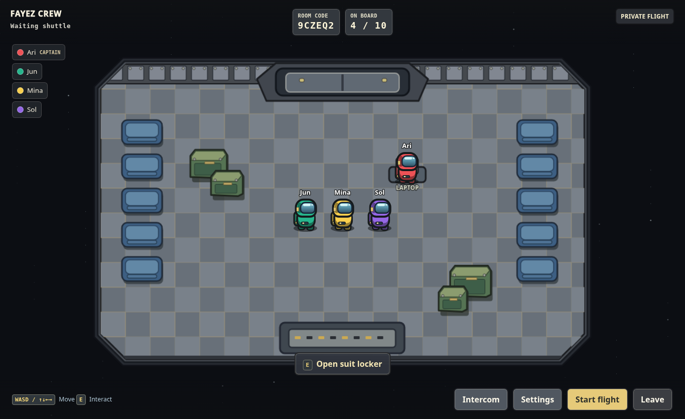
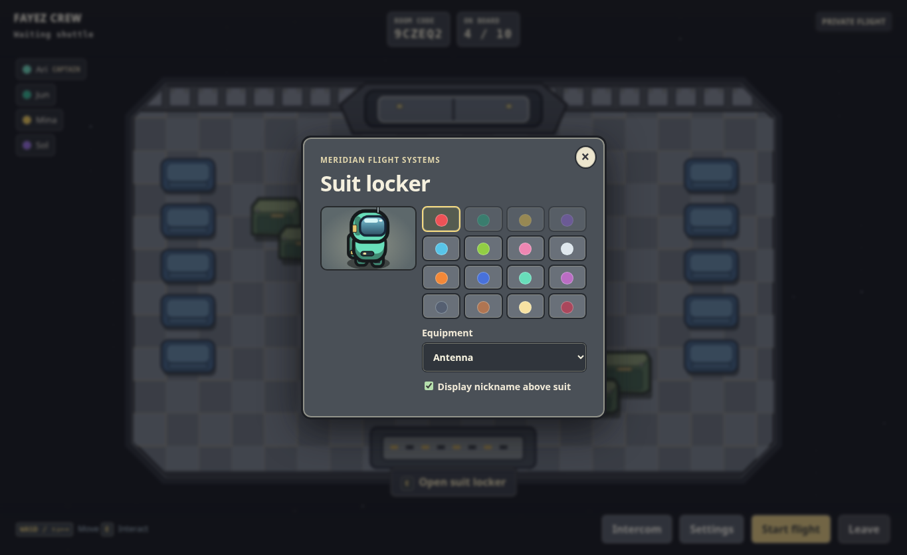
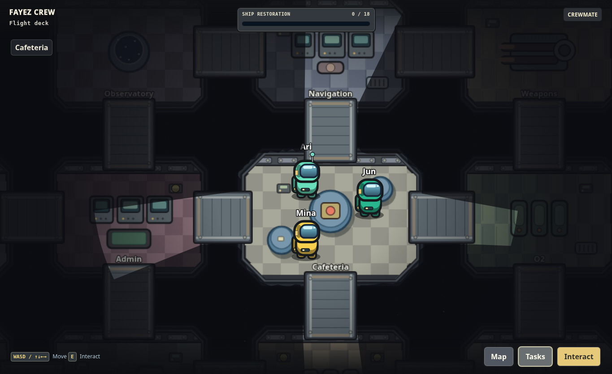
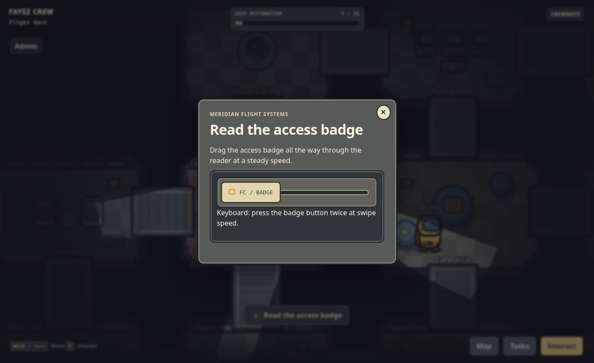
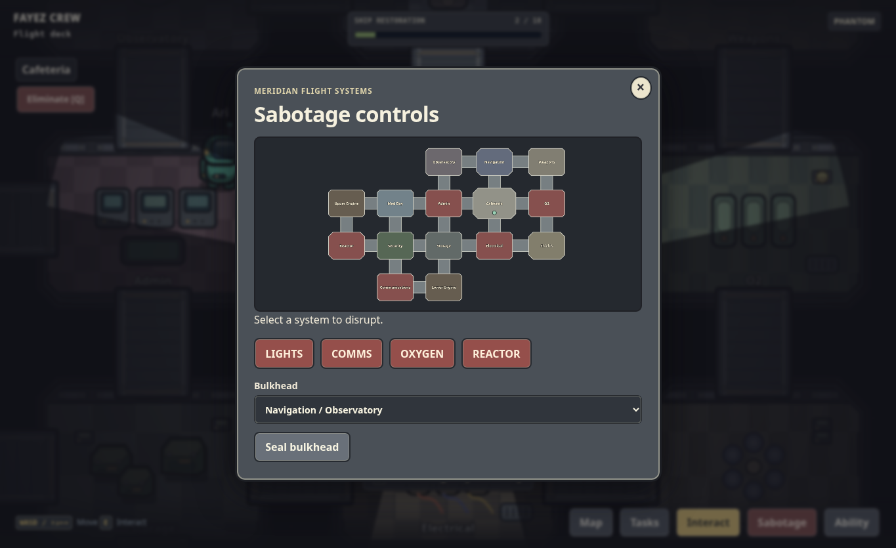
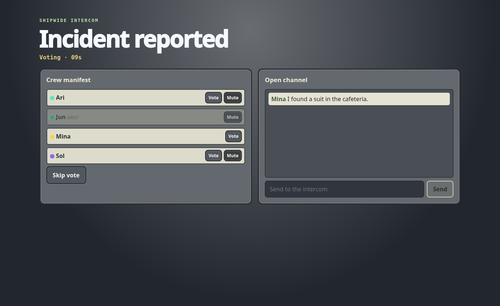

# Classic 2D visual comparison

Innersloth's official itch.io gallery supplied the dropship, suit and role introduction, emergency cut-in, voting and card reader references. The release trailer on the official Steam listing supplied additional motion frames for the pregame ship, character scale, hallways, chat and ejection. MobyGames supplied captures of the actual Skeld Cafeteria, sabotage schematic and wiring panel. The two user-supplied images were treated as supplemental references. Research images and extracted trailer frames were kept in the working research directory outside the game repository. The comparison links back to the original publishers. [Innersloth on itch.io](https://innersloth.itch.io/among-us) · [Innersloth release trailer on Steam](https://store.steampowered.com/app/945360/Among_Us/) · [MobyGames screenshots](https://www.mobygames.com/game/149316/among-us/screenshots/)

| Official game or external gameplay reference | Updated Fayez Crew gameplay |
| --- | --- |
| **Official waiting dropship**   | **Waiting shuttle**   |
| **Official role introduction and character scale**   | **Original suits and color selection**   |
| **Actual Skeld Cafeteria, MobyGames capture**   | **Fayez Crew Cafeteria**   |
| **Official badge reader**   | **Original access badge reader**   |
| **Actual Skeld sabotage map, MobyGames capture**   | **Fayez Crew sabotage controls**   |
| **Official voting panel**   | **Fayez Crew ballot**   |

| Area | Earlier Fayez Crew | Updated Fayez Crew |
| --- | --- | --- |
| Camera and scale | Lower zoom and glowing room silhouettes. | Slightly tighter top-down framing. Suit scale is consistent across the lobby and ship. Dark wall-aware sight follows the player. |
| Lobby | Blue light washes, slate cargo and a glowing terminal. | Gray chamfered steel, riveted walls, inset floor panels, blue padding, green crates and an illustrated laptop. Seats and crates block movement. |
| Suits | Circular full helmet visor with symmetrical tanks. | Compact stepped helmet, broad inset visor, one offset oxygen pack, visible chest hardware and alternating short boots. |
| Ship | Mostly rounded corners, thin outlines and repeated steel color. | Chamfered corners, heavy wall rims, differentiated floor textures and original room-specific props. |
| Interface | Bright teal dashboard accents. | Small off-white labels, painted gray consoles, yellow task cues and muted red alerts. |
| Tasks | Similar outer hardware panels for multiple hold actions. | Separate badge reader, circuit rack, fuel canister, scanner, waste lever and download/upload instruments. |
| Ballot | Dark navy text-first roster. | High-contrast roster cards, gray ballot board and adjacent intercom. |

[Full game screenshot gallery](screenshots/)

## Requested gameplay video

The requested YouTube watch page returned HTTP 403 on direct retrieval. Playback in Chrome was blocked by a tunnel connection error. No frames, map identifications, or timestamps below are attributed to that link. [Requested video](https://www.youtube.com/watch?v=Mj6tdAjFWOo)

The fallback used the genuine screenshots displayed above. Map-specific observations came from the Skeld Cafeteria, Admin reader, Electrical wiring and sabotage map captures. The official Steam release trailer is mixed-map and supplied only general presentation and movement cues. These windows are approximate because frames were sampled four seconds apart. [Official release trailer on Steam](https://store.steampowered.com/app/945360/Among_Us/)

| Approximate trailer time | Observation |
| --- | --- |
| 0:04–0:08 | Pregame shuttle with inward-facing blue seats, a gray hull, crates, and compact player names over saturated suits. |
| 0:08–0:12 | Overhead camera centered on the local character, with fast silhouette readability against muted flooring and dark walls. The room here was used only for general camera and suit reference. |
| 0:24–0:32 | Discussion bubbles and the ballot use large readable entries against a muted board. |
| 0:32–0:36 | The ejection reads immediately as a suit silhouette drifting against black space. |

Observed Skeld-specific cues were broad outlines around furniture, a tile checker that remains visible at normal zoom, seam lines that run across corridor floorboards, and local vision that darkens the next room behind its bulkhead. Fayez Crew now uses room-aware sight and clipped passages. The original map keeps its own transit routes and equipment placement. Exact walk-cycle timing could not be established from the sampled trailer stills.
